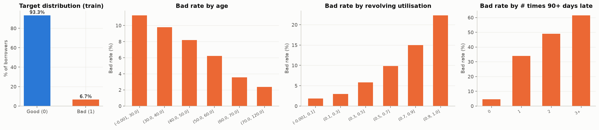
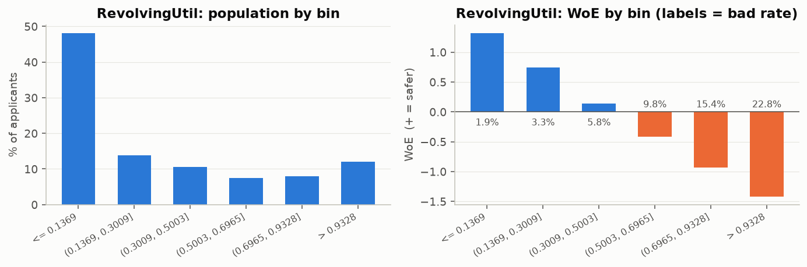
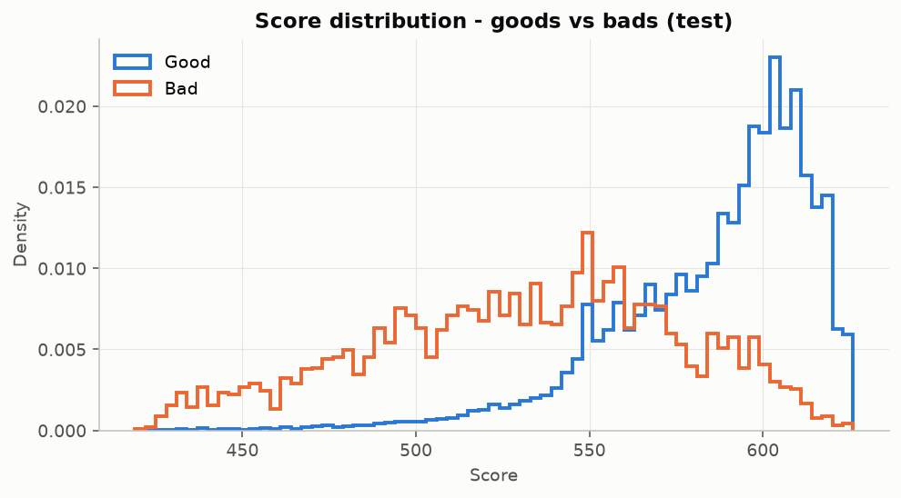
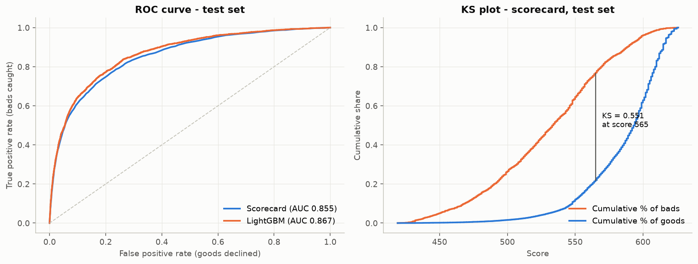
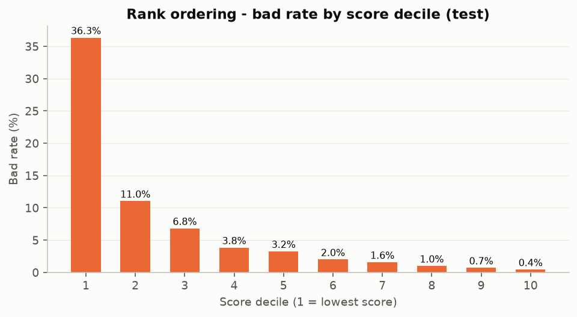
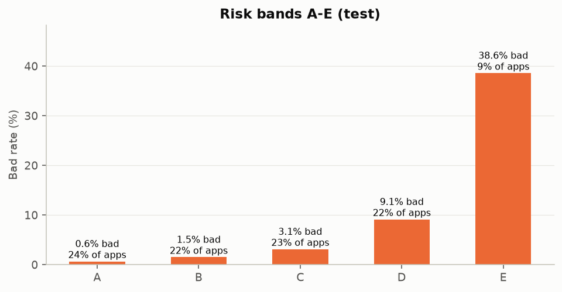
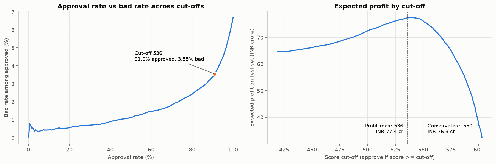
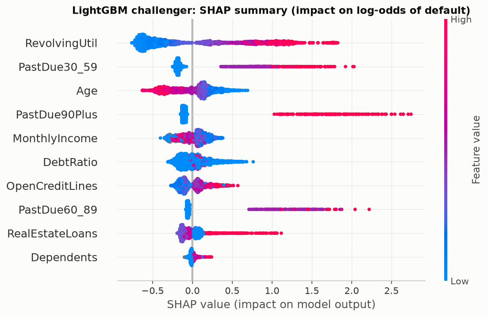
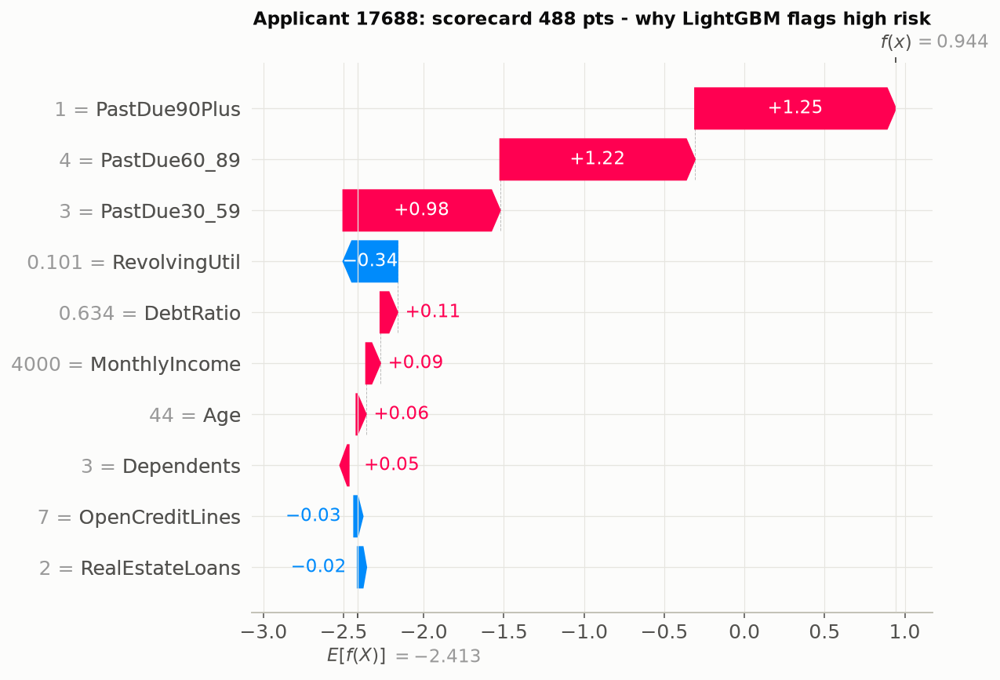

# Application Credit Scorecard: WoE/IV Logistic Regression vs LightGBM

An end-to-end **acquisition (application) credit scorecard** built on 150,000 borrowers. It covers the
full workflow: data cleaning, WoE binning, a points-based logistic regression scorecard, an ML
challenger, validation and monitoring, a profit-optimised cut-off strategy, and a Streamlit app that
scores a new applicant and explains its decision.

## Problem

A lender has to decide at the point of application whether to approve a loan, on what terms, or to
decline it. The model must **rank applicants by risk** and be **transparent** enough for credit policy,
auditors and the regulator to sign off. It must also turn into a **decision strategy** that makes money.

## Dataset

[Give Me Some Credit](https://www.kaggle.com/c/GiveMeSomeCredit) (Kaggle): `cs-training.csv`, with
150,000 borrowers and 10 characteristics. The target `SeriousDlqin2yrs` = 1 if the borrower went 90+
days past due within 2 years. **Bad rate: 6.68%.** The split is a stratified 70/30 train/test (seed 42).
Every cleaning threshold, bin and coefficient is fitted on train only.

## Approach

```
raw data (150K)
   │  clean: cap utilisation at 1, 96/98 delinquency codes -> worst genuine count,
   │         age 0 -> median, cap DebtRatio/income; keep missing as its own bin
   ▼
stratified 70/30 split ──────────────────────────────────────────────┐
   │                                                                   │
   ▼                                                                   ▼
WoE binning (tree fine-classing + monotonic merge) -> IV filter    LightGBM on raw features
   │  VIF < 5, sign & p-value checks                                   │  randomized search, 3-fold CV
   ▼                                                                   │  SHAP explanations
logistic regression -> points (600 @ 50:1, PDO 20)  ◄── champion vs challenger ──┘
   │
   ▼
validation: AUC / Gini / KS, gains & rank-ordering, PSI / CSI
   │
   ▼
strategy: profit curve -> cut-off, risk bands A-E -> Streamlit app with reason codes
```

## Key results (30% hold-out test set, 45,000 applicants)

| Model | Test AUC | Test Gini | Test KS | Train Gini | Gini gap |
|---|---|---|---|---|---|
| **Logistic scorecard (champion)** | **0.855** | **0.710** | **0.550** | 0.709 | −0.001 |
| LightGBM (challenger) | 0.867 | 0.734 | 0.575 | 0.759 | 0.025 |

- **Rank-ordering:** the bad rate falls in every score decile, from 36.3% to 0.4%. The lowest-scoring 10% of applicants contain **54.4% of all bads** (lift 5.4×).
- **Stability:** score PSI from train to test is 0.0003 (stable). That is expected for a random split, so see the limitations below.

### Cut-off strategy

Illustrative economics: average loan ₹2,00,000. A good loan earns 12% NIM (₹24,000) and a bad one
loses at 60% LGD (₹1,20,000), so the break-even bad rate is **16.7%**. The cut-off was chosen on train
and is reported on test:

| Strategy | Approval rate | Bad rate (approved) | Bads avoided | Expected profit |
|---|---|---|---|---|
| Approve everyone | 100% | 6.68% | 0% | ₹64.7 cr |
| **Profit-max cut-off ≥ 536** | **91.0%** | **3.55%** | **51.7%** | **₹77.4 cr (+19.7%)** |
| Conservative cut-off ≥ 550 | 85.3% | 2.87% | 63.4% | ₹76.3 cr |

### Risk bands

| Band | Score | % of applicants | Bad rate | Action |
|---|---|---|---|---|
| A | ≥ 607 | 23.5% | 0.6% | Auto-approve |
| B | 595 – 606 | 22.0% | 1.5% | Approve with lower limit |
| C | 573 – 594 | 23.0% | 3.1% | Manual review |
| D | 536 – 572 | 22.5% | 9.1% | Approve with higher pricing or collateral |
| E | < 536 | 9.0% | 38.6% | Decline |

## Charts

| | |
|---|---|
|  |  |
|  |  |
|  |  |



| SHAP summary (challenger) | SHAP for one declined applicant |
|---|---|
|  |  |

## Business recommendations

1. **Deploy the logistic scorecard as champion with a cut-off of 536.** It declines 9% of applicants,
   avoids about half of the defaults, and adds roughly 20% to expected profit compared with approving everyone.
2. **Use the bands for terms, not just yes/no.** Band D (9.1% bad rate) is still below the 16.7%
   break-even, so it is profitable with risk-based pricing or collateral. Band C goes to underwriters.
3. **Move to the conservative cut-off (550)** if capital is tight, LGD assumptions are uncertain, or
   the product is unsecured with weak recoveries. It costs under 2% of profit for 0.7 pp lower bad rate.
4. **Keep LightGBM as a challenger.** It shows about 2.3 Gini points of headroom. Use its SHAP drivers
   to look for interactions worth adding to the scorecard, and as a second opinion in manual review.

**Why logistic regression stays champion:** every point traces to a bin, which gives clean reason codes
for declined applicants. Monotonic, sign-checked WoE variables are easy to justify to credit policy and
under RBI model-risk and fair-lending expectations. The scorecard is also stable (no train-test gap) and
simple to monitor and recalibrate. LightGBM gains a few Gini points but overfits more and is harder to
explain decision by decision.

## Project structure

```
├── data/                        raw csv (not committed)
├── notebooks/credit_scorecard.ipynb   narrative notebook, executed with outputs
├── src/
│   ├── config.py                paths, seed, scaling and economics constants
│   ├── data_prep.py             load, split, train-fitted Cleaner
│   ├── binning.py               monotonic WoE binning + IV
│   ├── scorecard.py             VIF, sign checks, logistic fit, points table, reason codes
│   ├── challenger.py            LightGBM search + SHAP
│   ├── validation.py            AUC/Gini/KS, gains table, calculate_psi(), CSI
│   └── strategy.py              cut-off/profit table, risk bands
├── models/                      scorecard_artifacts.joblib, lgbm_challenger.joblib, scorecard_table.csv
├── reports/                     figures/, IV, gains, bands, cut-offs, results.json
└── app.py                       Streamlit scoring app
```

## How to run (Windows)

```bat
python -m venv .venv
.venv\Scripts\activate.bat
pip install --only-binary :all: -r requirements.txt
:: put cs-training.csv in data\
jupyter nbconvert --to notebook --execute --inplace notebooks\credit_scorecard.ipynb
streamlit run app.py
```

The notebook takes about 1.5 minutes to run and writes every figure, table and model artifact.

**Python 3.15 note:** `optbinning` needs Google OR-Tools, which has no Python 3.15 build, so
`src/binning.py` implements the same approach: tree-based fine classing, then merging into monotonic
coarse classes, with a separate Missing bin.

## Limitations and next steps

- **Reject inference:** the data only contains *approved* borrowers, so the model has never seen the
  applicants who were declined. Next step: parcelling or fuzzy augmentation to correct this selection bias.
- **Out-of-time validation:** the test set is a random split from the same period, so PSI ≈ 0 and the
  metrics are optimistic. A real validation would test on a later vintage.
- **Behavioural scorecard:** use repayment behaviour on the book (DPD history, utilisation trend) for
  limit management and early collections.
- **Segmentation:** separate scorecards for thin-file/young borrowers or by income band, where the
  drivers differ.
- **Calibration:** the bins were chosen on development data and the PD is not recalibrated to the
  current portfolio's central tendency.
- **Richer data:** bureau scores and enquiries, product, tenure, collateral and banking transactions
  would add signal that this 10-variable dataset can't provide.
